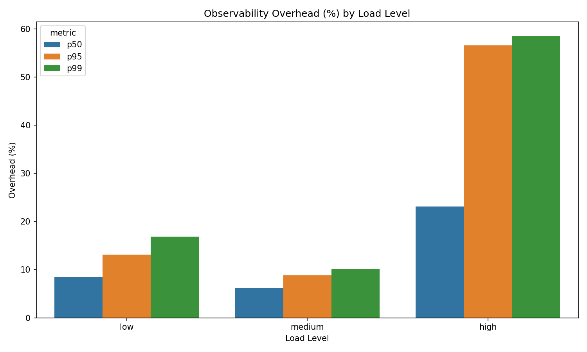
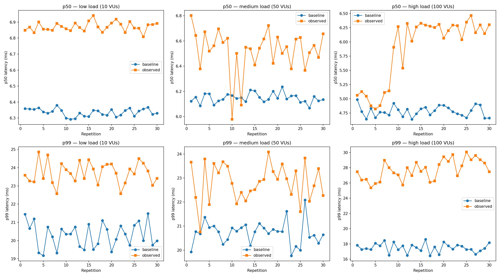
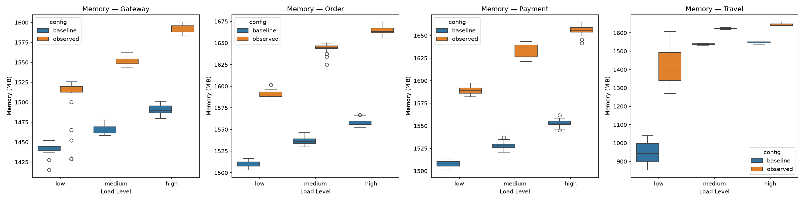
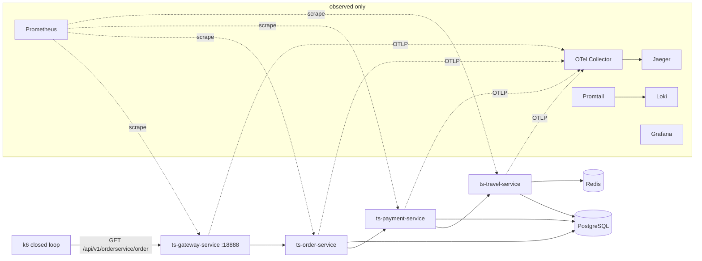

# Observability Overhead Benchmark

[Leia em português](README.pt-BR.md)

A reproducible performance evaluation for the paper **"Avaliação do Overhead de Desempenho
Introduzido por Ferramentas de Observabilidade em Sistemas de Microsserviços"** (Performance
overhead of observability tools in microservice systems), UFC, 2026. It measures how much latency,
throughput, CPU and memory a full observability stack (OpenTelemetry Java agent, Prometheus, Loki,
Jaeger, Grafana) costs a chain of Spring Boot microservices.

The paper is [`docs/paper.pdf`](docs/paper.pdf); [`docs/README.md`](docs/README.md) explains how it
relates to this repository. Every claim it makes is checked against the data in the
[credibility checklist](docs/credibility-checklist.md).

## Results

2 configurations (without and with observability) × 3 loads (10, 50, 100 virtual users) × 30
repetitions of 5.5 min = 180 runs. Values are means over the 30 runs.

| Load | p50 overhead | p95 overhead | p99 overhead | Throughput loss |
|---|---|---|---|---|
| 10 VUs | +8.4 % (+0.54 ms) | +13.1 % (+1.52 ms) | +16.9 % (+3.42 ms) | 0.6 % |
| 50 VUs | +6.1 % (+0.38 ms) | +8.8 % (+1.06 ms) | +10.1 % (+2.10 ms) | 0.4 % |
| 100 VUs | +23.1 % (+1.10 ms) | +56.6 % (+6.23 ms) | +58.5 % (+10.24 ms) | 1.8 % |

- Latency overhead is significant at every load and percentile (t-test or Mann-Whitney U,
  p < 0.001).
- At 100 VUs the overhead is largest, mostly in the tail. The baseline shows no saturation there,
  and the mechanism was not isolated.
- Container memory grows 4.6–7.0 % in the instrumented services (the travel service at 10 VUs is
  an outlier at +49 %). CPU stays below 1 % of a core on
  average, and its differences are significant in every service only at 100 VUs.







All CSVs and figures are in [`results/`](results/).

## Architecture



- **Services**: Spring Boot 3.3.6, Java 21, adapted from the TrainTicket benchmark.
- **Baseline**: [`docker-compose.baseline.yml`](docker-compose.baseline.yml), the services,
  PostgreSQL and Redis only.
- **Observed**: [`docker-compose.yml`](docker-compose.yml), the same services with the
  OpenTelemetry Java agent plus the whole stack. The application code is the same.

Details and design decisions are in [`docs/architecture.md`](docs/architecture.md).

## Requirements

- Docker with Compose v2.
- About 12 GB of free RAM: each of the four JVMs reserves a fixed 2 GB heap.
- For the full experiment: `curl`, `mpstat` (package `sysstat`) and, optionally, k6. Without a
  local k6 the script runs the `grafana/k6` image on the host network.
- For the analysis: Python 3 with `pip install -r scripts/requirements.txt`.

## Quick start

```bash
./bench.sh up observed      # downloads the OTel agent on first use, builds and starts
./bench.sh smoke            # 100 requests through the gateway
./bench.sh up baseline      # same services, no observability
./bench.sh down
```

| Tool (observed only) | URL |
|---|---|
| Grafana (admin / admin) | http://localhost:3000 |
| Jaeger | http://localhost:16686 |
| Prometheus | http://localhost:9090 |
| Gateway | http://localhost:18888/api/v1/orderservice/order |

In Jaeger, one request is a trace of 16 spans across the gateway and the three services.

## Running the experiment

```bash
./bench.sh run --dry-run    # print the 180 runs
./bench.sh run              # about 17 hours; resumes where it stopped
./bench.sh analyze          # statistics, CSVs and figures into results/
```

Each run tears the stack down, starts it again, warms up for 30 s and runs k6 for 5.5 min. The
raw k6 output (about 0.1 to 1 GB per run) is git-ignored. The original raw files were deleted
after the analysis for disk space, so `analyze` needs a new run to rebuild the latency CSVs.

## Credibility

- [Credibility checklist](docs/credibility-checklist.md): all 66 checkable claims of the paper,
  with status and evidence.
- [Divergences](docs/divergences.md): what the delivered paper said that the data did not
  support, and how the revised paper says it.

## Security note

This is a local benchmark. Grafana uses `admin`/`admin`, PostgreSQL uses `postgres`/`postgres`,
every port is published on all interfaces and Promtail mounts the Docker socket. Do not expose it
to a network.

## Credits

Luiz Matheus Sena Macedo, Arthur Anderson Guimarães Lopes and Lucas Alves Meneses. Final project
of the course Avaliação de Desempenho de Sistemas Computacionais (CKP8555), taught by José Neuman
de Souza and Paulo A. L. Rego, Mestrado e Doutorado em Ciência da Computação (MDCC), Universidade
Federal do Ceará (UFC).
