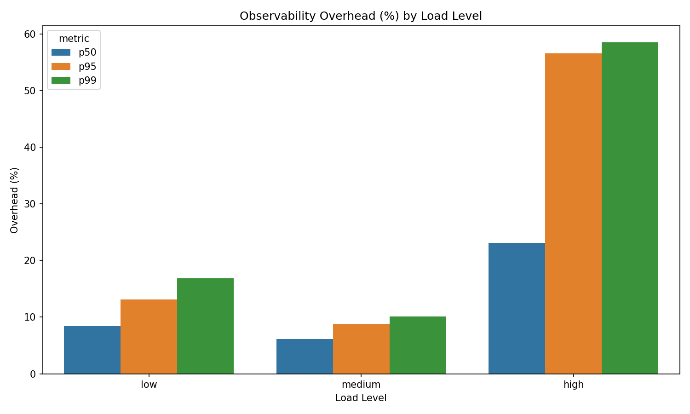
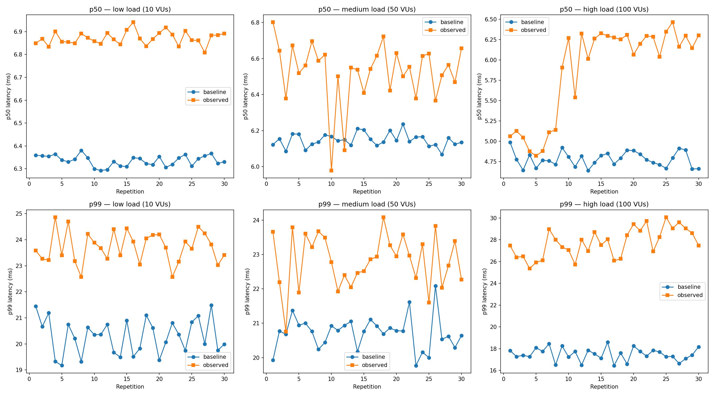
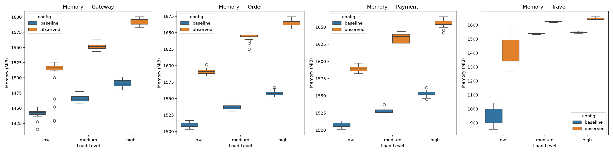
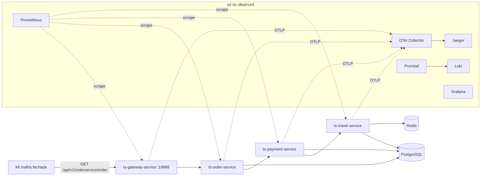

# Observability Overhead Benchmark

[Read in English](README.md)

Avaliação de desempenho reproduzível do artigo **"Avaliação do Overhead de Desempenho Introduzido
por Ferramentas de Observabilidade em Sistemas de Microsserviços"**, UFC, 2026. Mede quanto de
latência, vazão, CPU e memória uma stack completa de observabilidade (agente Java do
OpenTelemetry, Prometheus, Loki, Jaeger, Grafana) custa a uma cadeia de microsserviços Spring Boot.

O artigo está em [`docs/paper.pdf`](docs/paper.pdf); o [`docs/README.md`](docs/README.md) explica a
relação dele com este repositório. Cada afirmação do artigo é conferida contra os dados no
[checklist de credibilidade](docs/credibility-checklist.md).

## Resultados

2 configurações (sem e com observabilidade) × 3 cargas (10, 50 e 100 usuários virtuais) × 30
repetições de 5,5 min = 180 execuções. Valores são médias das 30 execuções.

| Carga | Overhead p50 | Overhead p95 | Overhead p99 | Perda de vazão |
|---|---|---|---|---|
| 10 VUs | +8,4 % (+0,54 ms) | +13,1 % (+1,52 ms) | +16,9 % (+3,42 ms) | 0,6 % |
| 50 VUs | +6,1 % (+0,38 ms) | +8,8 % (+1,06 ms) | +10,1 % (+2,10 ms) | 0,4 % |
| 100 VUs | +23,1 % (+1,10 ms) | +56,6 % (+6,23 ms) | +58,5 % (+10,24 ms) | 1,8 % |

- O overhead de latência é significativo em todas as cargas e percentis (teste t ou Mann-Whitney
  U, p < 0,001).
- Em 100 VUs o overhead é maior, sobretudo na cauda. O baseline não mostra saturação nesse nível,
  e o mecanismo não foi isolado.
- A memória dos contêineres cresce 4,6–7,0 % nos serviços instrumentados (o travel-service em
  10 VUs é a exceção, com +49 %). A CPU fica abaixo de 1 % de um núcleo em média, e as diferenças
  são significativas em todos os serviços apenas em 100 VUs.







Todos os CSVs e figuras estão em [`results/`](results/).

## Arquitetura



- **Serviços**: Spring Boot 3.3.6, Java 21, adaptados do benchmark TrainTicket.
- **Baseline**: [`docker-compose.baseline.yml`](docker-compose.baseline.yml), só os serviços,
  PostgreSQL e Redis.
- **Observed**: [`docker-compose.yml`](docker-compose.yml), os mesmos serviços com o agente Java do
  OpenTelemetry e a stack completa. O código da aplicação é o mesmo.

Detalhes e decisões de projeto em [`docs/architecture.md`](docs/architecture.md).

## Requisitos

- Docker com Compose v2.
- Cerca de 12 GB de RAM livre: cada uma das quatro JVMs reserva um heap fixo de 2 GB.
- Para o experimento completo: `curl`, `mpstat` (pacote `sysstat`) e, opcionalmente, k6. Sem k6
  local, o script usa a imagem `grafana/k6` na rede do host.
- Para a análise: Python 3 com `pip install -r scripts/requirements.txt`.

## Início rápido

```bash
./bench.sh up observed      # baixa o agente OTel na primeira vez, builda e sobe
./bench.sh smoke            # 100 requisições pelo gateway
./bench.sh up baseline      # mesmos serviços, sem observabilidade
./bench.sh down
```

| Ferramenta (só no observed) | URL |
|---|---|
| Grafana (admin / admin) | http://localhost:3000 |
| Jaeger | http://localhost:16686 |
| Prometheus | http://localhost:9090 |
| Gateway | http://localhost:18888/api/v1/orderservice/order |

No Jaeger, cada requisição é um trace de 16 spans passando pelo gateway e pelos três serviços.

## Rodando o experimento

```bash
./bench.sh run --dry-run    # lista as 180 execuções
./bench.sh run              # cerca de 17 horas; retoma de onde parou
./bench.sh analyze          # estatística, CSVs e figuras em results/
```

Cada execução derruba a stack, sobe de novo, aquece por 30 s e roda o k6 por 5,5 min. A saída
bruta do k6 (de 0,1 a 1 GB por execução) fica fora do git. Os arquivos brutos originais foram
apagados depois da análise por falta de espaço, então o `analyze` precisa de uma nova rodada para
refazer os CSVs de latência.

## Credibilidade

- [Checklist de credibilidade](docs/credibility-checklist.md): as 66 afirmações verificáveis do
  artigo, com status e evidência.
- [Divergências](docs/divergences.md): o que o artigo entregue dizia e os dados não sustentavam, e
  como o artigo revisado diz agora.

## Aviso de segurança

Este é um benchmark local. O Grafana usa `admin`/`admin`, o PostgreSQL usa `postgres`/`postgres`,
todas as portas são publicadas em todas as interfaces e o Promtail monta o socket do Docker. Não
exponha em rede.

## Créditos

Luiz Matheus Sena Macedo, Arthur Anderson Guimarães Lopes e Lucas Alves Meneses. Trabalho final da
disciplina Avaliação de Desempenho de Sistemas Computacionais (CKP8555), ministrada por José Neuman
de Souza e Paulo A. L. Rego, Mestrado e Doutorado em Ciência da Computação (MDCC), Universidade
Federal do Ceará (UFC).
