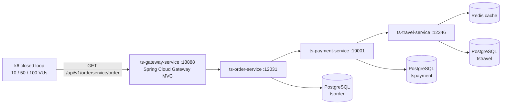

# Architecture

## What is measured

The latency, throughput, CPU and memory cost of attaching a full observability stack (OpenTelemetry
Java agent, Prometheus, Loki with Promtail, Jaeger, Grafana) to a small Spring Boot microservice
chain. The same services run twice: once without any telemetry (baseline) and once with the
whole stack (observed). Everything else stays the same.

## System under test

| Service | Per request |
|---|---|
| `ts-gateway-service` | Routes `/api/v1/orderservice/**` to the order service. |
| `ts-order-service` | Calls the payment service, then reads all orders from `tsorder`. |
| `ts-payment-service` | Calls the travel service, then reads all payments from `tspayment`. |
| `ts-travel-service` | Returns all trips, cached in Redis (`@Cacheable`), so the database is hit only on a cache miss. |

All four services: Spring Boot 3.3.6, Java 21 (Eclipse Temurin), fixed 2 GB heap
(`-Xms2g -Xmx2g`), G1GC. The services and data model are adapted from the TrainTicket benchmark
(Zhou et al., 2021); the database schema and seed are in [`postgres/init.sql`](../postgres/init.sql).

## The two configurations

| | Baseline ([`docker-compose.baseline.yml`](../docker-compose.baseline.yml)) | Observed ([`docker-compose.yml`](../docker-compose.yml)) |
|---|---|---|
| Services, PostgreSQL, Redis | yes | yes |
| OpenTelemetry Java agent 2.11.0 (`JAVA_TOOL_OPTIONS=-javaagent:...`) | no | yes, in all four services |
| OTel Collector (batch 1024 / 5 s) | no | traces to Jaeger, OTLP metrics to a Prometheus exporter |
| Prometheus (scrapes `/actuator/prometheus` every 15 s) | no | yes |
| Promtail (reads container logs) and Loki | no | yes |
| Jaeger all-in-one, Grafana | no | yes |

The application code is identical. Micrometer and the actuator endpoint exist in both
configurations; in the baseline nobody scrapes them. No container has a CPU or memory limit.

## How a run works

[`scripts/run-experiments.sh`](../scripts/run-experiments.sh) repeats this cycle for
2 configurations × 3 loads × 30 repetitions = 180 runs:

1. `docker compose down -v`, then `up -d --build`: every run starts from fresh containers and
   empty volumes.
2. Wait until `/api/v1/orderservice/welcome` answers, then send one request per second for 30 s
   to warm up the JVMs.
3. Run k6 ([`load/`](../load/)): 30 s ramp to the target VUs plus 5 min constant, each VU sleeping
   100 ms between requests. The ramp is part of the measured window. k6 writes one JSON file per
   run with every request.
4. Sample `docker stats` once per service at the end of the run and append it to
   `results/metrics.csv`. Host CPU (`mpstat`) and a 0.5 s `docker stats` series are also recorded
   in raw files, but the paper does not use them.

[`scripts/analyze.py`](../scripts/analyze.py) then reads the JSON files and computes, per run, the
latency percentiles, throughput, tail shares and the k6 phase breakdown; it applies Shapiro-Wilk
and then a Student t-test or Mann-Whitney U per (metric, load) at α = 0.05, and writes the CSVs and
figures in [`results/`](../results/).

## Design decisions

- **Two compose files instead of a flag.** The baseline must not start any observability
  container, so it is a separate file rather than environment toggles inside one file.
- **Zero-code instrumentation.** The OTel Java agent is mounted as a volume and attached with
  `JAVA_TOOL_OPTIONS`, so the service images are the same in both configurations.
- **Closed-loop load with think time.** k6 VUs wait for each answer and sleep 100 ms. This keeps
  the request rate tied to the VU count, which is easy to compare across runs, but it means
  throughput mostly mirrors latency and the experiment does not measure maximum capacity.
- **Fresh environment per repetition.** Tearing down and rebuilding the stack between runs costs
  time (the full experiment takes about 17 hours) but stops one run's caches, JIT state or
  volumes from leaking into the next.
- **Single host.** Load generator, services and observability stack share one machine, so host
  contention is part of the measured overhead. The paper lists it as a threat to validity.

## Known limits

- One `docker stats` sample per run is a weak CPU measure: averages stay under 1 % of a core but
  single samples reach 4.75 %. The paper treats the CPU results as indicative.
- `metrics.csv` is appended to, so a re-run scenario leaves an older batch above the new one.
  `analyze.py` keeps the newest 30 rows per scenario (see [`divergences.md`](divergences.md)).
- No GC, per-span or per-component CPU data was collected, so the paper does not explain *why* the
  overhead is larger at 100 VUs.
